# Guild Monitor

**English** · [Português](README.pt-BR.md)

A [Claude Code](https://claude.com/claude-code) mod that turns your session monitor into a tiny RPG. A guild of three pixel-art characters lives above your prompt, works while the agent works, and levels up as tasks get done. Your usage limits, context window and cost show up as game meters.

> **Not affiliated with Anthropic.** The orange mascot is a fan-made homage to the Claude Code mascot. "Claude" and "Claude Code" are trademarks of Anthropic.

<p align="center">
  
  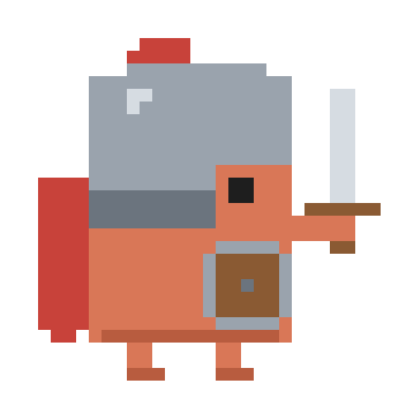
  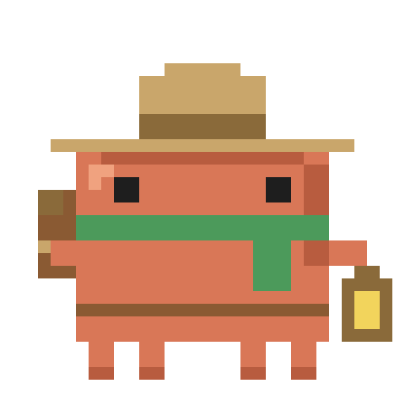
  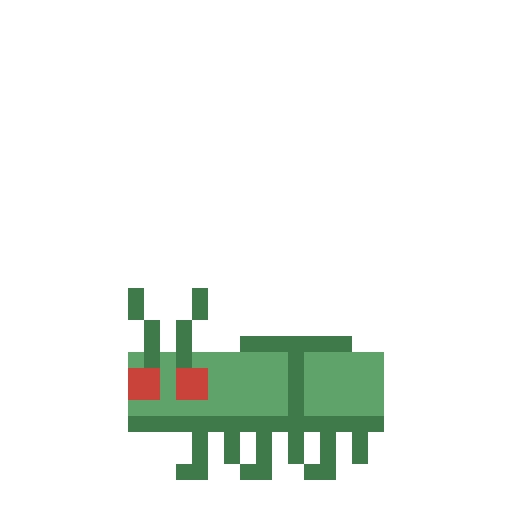
</p>

## What it does

- **Three characters, one per kind of work.** The one on stage follows what the agent is *doing*, not what you typed.
- **Animated in the terminal.** Full-size sprites (32×16 cells) drawn with half-block characters and truecolor, with no image protocol needed. Works in iTerm2, foot and inside tmux.
- **Meters** for the 7-day limit, the 5-hour limit, the context window and the session cost.
- **XP and levels per class**, paid per operation and kept between sessions.
- **A bug** that shows up every time a tool call fails and is defeated when it works again.

## The guild

| Character | Does | Comes on stage when the agent… |
|---|---|---|
| **Mage** | plans | is in plan mode, or organises the work (`TodoWrite`, `AskUserQuestion`, plan tasks, `Plan` subagents) |
| **Warrior** | executes and fixes | changes things: `Edit`, `Write`, `MultiEdit`, shell commands that are not read-only, other subagents |
| **Explorer** *(default)* | researches and investigates | reads or searches: `Read`, `Grep`, `Glob`, `WebSearch`, `WebFetch`, read-only shell commands, `Explore` subagents |

The character on stage is the one most of the **last three tool calls** belong to (a tie goes to the latest). Before the first tool call of a turn, the prompt gives a first guess ("fix the bug" → Warrior, "plan the feature" → Mage); with nothing to go on, it is the Explorer.

### States

| State | When | Animation |
|---|---|---|
| working | a turn is running | the active character works |
| tired | context ≥ 75% (configurable) | everyone looks worn out |
| asleep | idle for 90 s (configurable) | everyone sleeps |
| idle | otherwise | everyone waits, blinking |

<table align="center">
  <tr>
    <td align="center">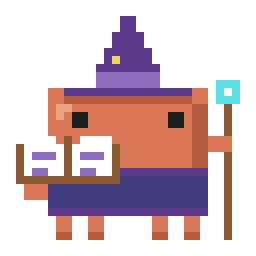<br>Mage working</td>
    <td align="center"><br>Warrior working</td>
    <td align="center">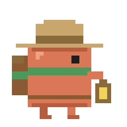<br>Explorer working</td>
    <td align="center"><br>Bug</td>
  </tr>
  <tr>
    <td align="center">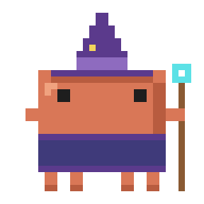<br>Idle</td>
    <td align="center">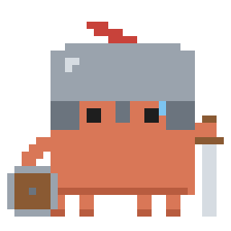<br>Tired</td>
    <td align="center">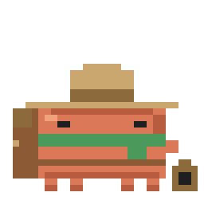<br>Asleep</td>
    <td align="center">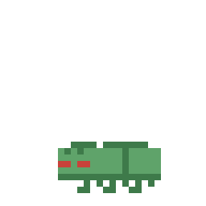<br>Defeated</td>
  </tr>
</table>

## Meters

| Meter | Shows | Color |
|---|---|---|
| **HP** | what is left of the 7-day usage window | green above 50%, yellow 25–50%, red below 25% |
| **MP** | what is left of the 5-hour window, with the time until it resets | blue |
| **ST** (stamina) | what is left of the context window | orange |
| **Gold** | what the session has cost, in USD | gold |
| **XP** | progress to the next level of the active character | purple |

HP and MP come from your subscription's rate limits: outside a subscription (for instance with an API key) they show `--`. A figure the session has not reported yet keeps its last known value, so the meters never blank when you switch characters.

## XP and levels

Every tool call that finishes **without error** pays XP at once to the class it belongs to, so a task that explores, plans and then executes feeds all three characters:

```
operation XP = 2  +  min(seconds / 2, 4)  +  min(lines written / 20, 4)      (10 at most)
```

- Time is how long the call ran. Lines are what an edit or a new file wrote.
- Defeating a bug pays **+10** to the class that made the passing call.
- A turn that ends with an answer pays **+3** to the active class.
- Interrupted turns keep what was already paid.

Level `n` starts at `40 × (n − 1)²` XP: level 2 at 40, level 3 at 160, level 4 at 360, level 5 at 640. XP is saved in the plugin store (`guild.v1`) and survives restarts. A toast announces each new level.

## The bug

When a tool call fails, the bug appears under the active character's stats. A later successful call **of the same kind** defeats it (for shell commands, the same program and subcommand: `npm test`, `git push`; for other tools, the same tool). Calls refused by a permission or a hook are not failures.

## Requirements

- Claude Code with mod support. Developed and tested on **2.1.302**.
- A terminal with truecolor. Tested on **iTerm2** (macOS) and **foot** (Linux), with and without **tmux** (use `set -ga terminal-features ",*:RGB"` or `Tc` if colors look flat).
- 16 rows free above the prompt for the full-size band (the reduced one needs 8).

## Install

Pick one.

**1. From the marketplace in this repo**

```sh
claude plugin marketplace add viniciusilveira/guild-monitor
claude plugin install guild-monitor@guild-monitor
```

**2. Load it from a clone, for one session**

```sh
git clone https://github.com/viniciusilveira/guild-monitor.git
claude --plugin-dir ./guild-monitor
```

**3. Load it from a clone, for every session**

```sh
export CLAUDE_CODE_PLUGIN_DIRS="$HOME/guild-monitor"
```

Restart Claude Code and the guild appears above the prompt.

## Configuration

| Option | Default | What it does |
|---|---|---|
| `sleepAfterSeconds` | `90` | idle time after which the guild falls asleep |
| `tiredAtPercent` | `75` | context filling at which everyone gets tired |
| `bandSize` | `full` | `full`: active character full size (16 rows); `compact`: everyone reduced (8 rows) |
| `demo` | `off` | a fixed scene with made-up figures: `explorador`, `mago`, `guerreiro`, `bug`, `cansado`, `dormindo` |

Set them on install (`claude plugin install … --config bandSize=compact`), with `claude plugin configure guild-monitor`, or in `/plugin`.

The band adapts to the terminal: first the active character, then the stats beside it, then the other two characters. It hides when even the active character does not fit.

### Demo mode

`demo` shows invented numbers (HP 72%, MP 45% with 2h13 to reset, ST 64%, $3.42, a level-4 Warrior) in a fixed scene and **ignores the real session and saves nothing**. Handy for screenshots and for a first look. Leave it at `off` for real use.

## Screenshots

<!--
Add real captures of the demo scenes in docs/screenshots/ and uncomment:

| Explorer | Mage | Warrior |
|---|---|---|
| 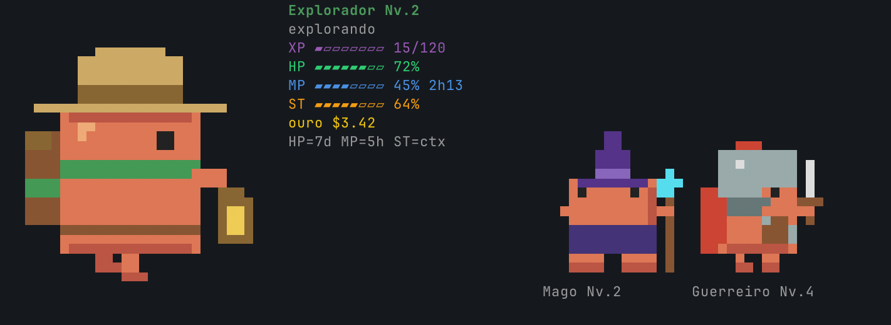 | 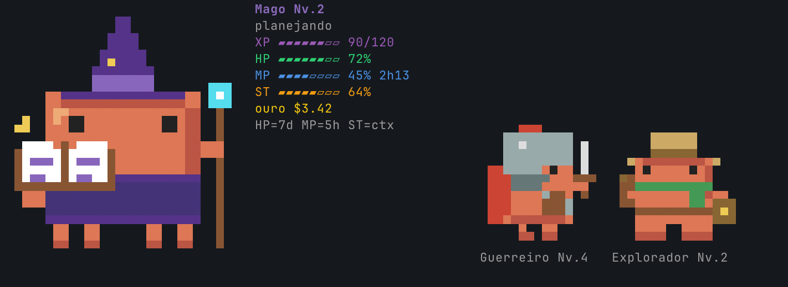 | 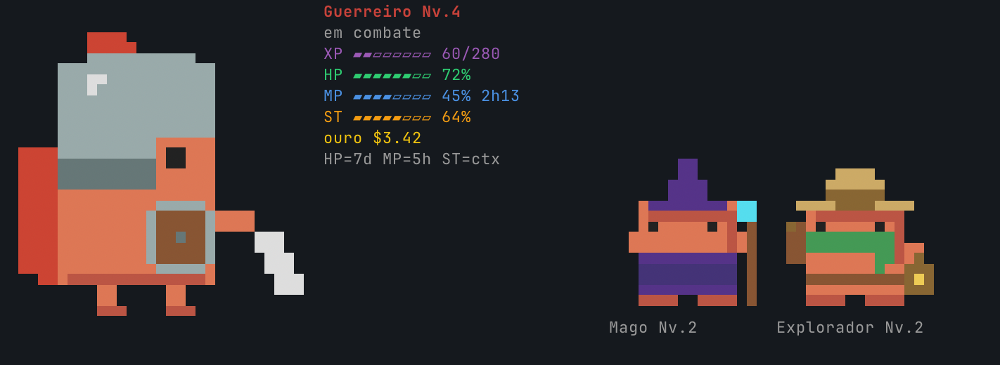 |

| Bug | Tired | Asleep |
|---|---|---|
| 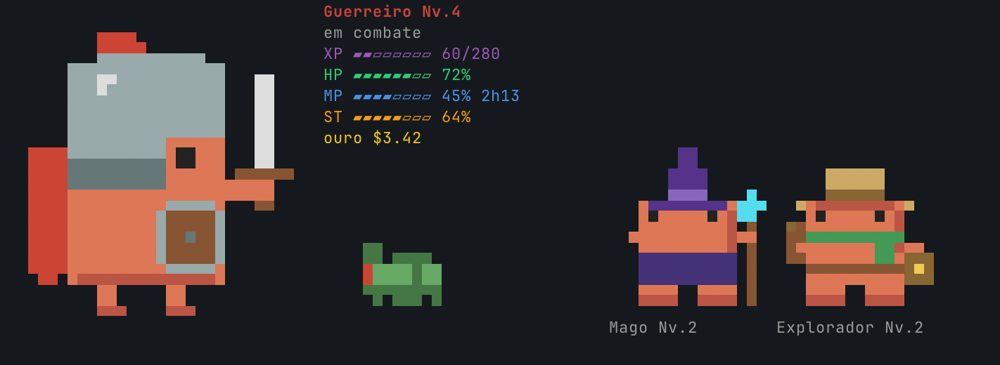 | 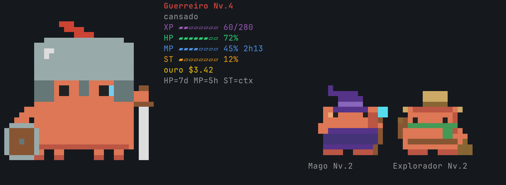 | 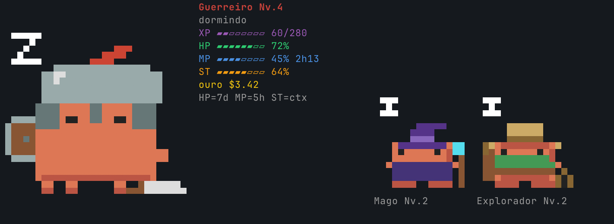 |
-->

Terminal captures of each demo scene are coming. Meanwhile, set `demo` to any scene to see it in your own terminal.

## Development

```sh
claude plugin test .       # unit tests of the pure modules
claude plugin validate .   # manifest and hook checks
tsc -p .                   # type check (see below)
node scripts/build-sprites.mjs   # rebuild hooks/sprites.generated.ts from art/
```

- `.claude-plugin/types/` holds the Claude Code type declarations, which the engine writes there when it loads the plugin as a mod. It is git-ignored; `tsc -p .` needs it.
- All the logic is in small pure modules with tests: `classify.ts` (who is on stage), `guild.ts` (animation states and the bug), `xp.ts` (XP and levels), `tracker.ts` (everything the guild remembers), `view.ts` (what the band shows), `layout.ts`, `raster.ts` (sprite → half-block cells), `demo.ts`. Only `register.tsx` and `render.tsx` talk to the engine.
- The mod runs without Node or a DOM, so it cannot decode PNG. `scripts/build-sprites.mjs` reads the Aseprite export in `art/` and writes the frames as data (`hooks/sprites.generated.ts`), plus a half-size version of each one for the small characters.
- The art was made in Aseprite (32×32 frames, one shared 21-color palette).

## Roadmap

- `/monitor` panel with the three characters at full size, per-class XP, cost and the latest operations.
- A short status line for when the band is hidden.

## License

[MIT](LICENSE), code and art alike. Not affiliated with, endorsed by or sponsored by Anthropic.
