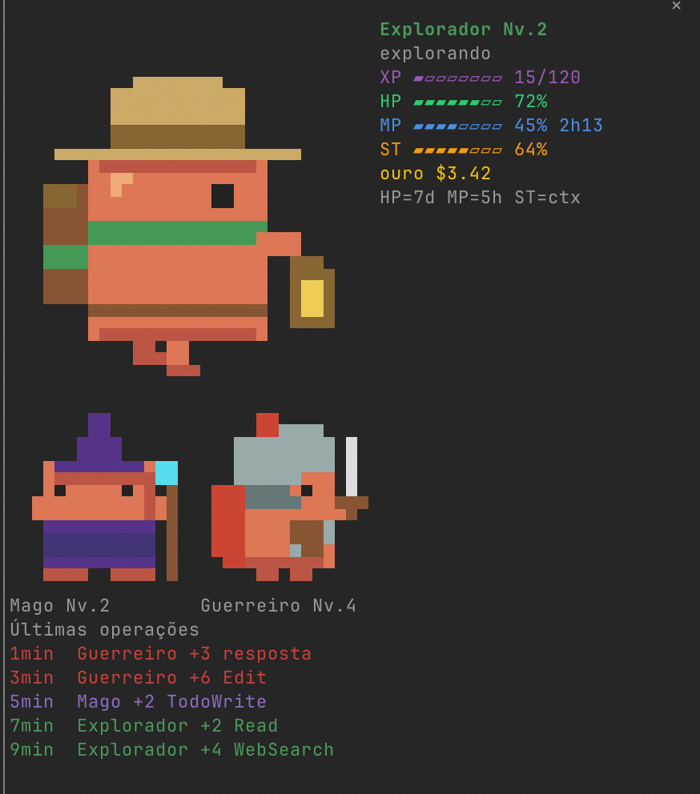
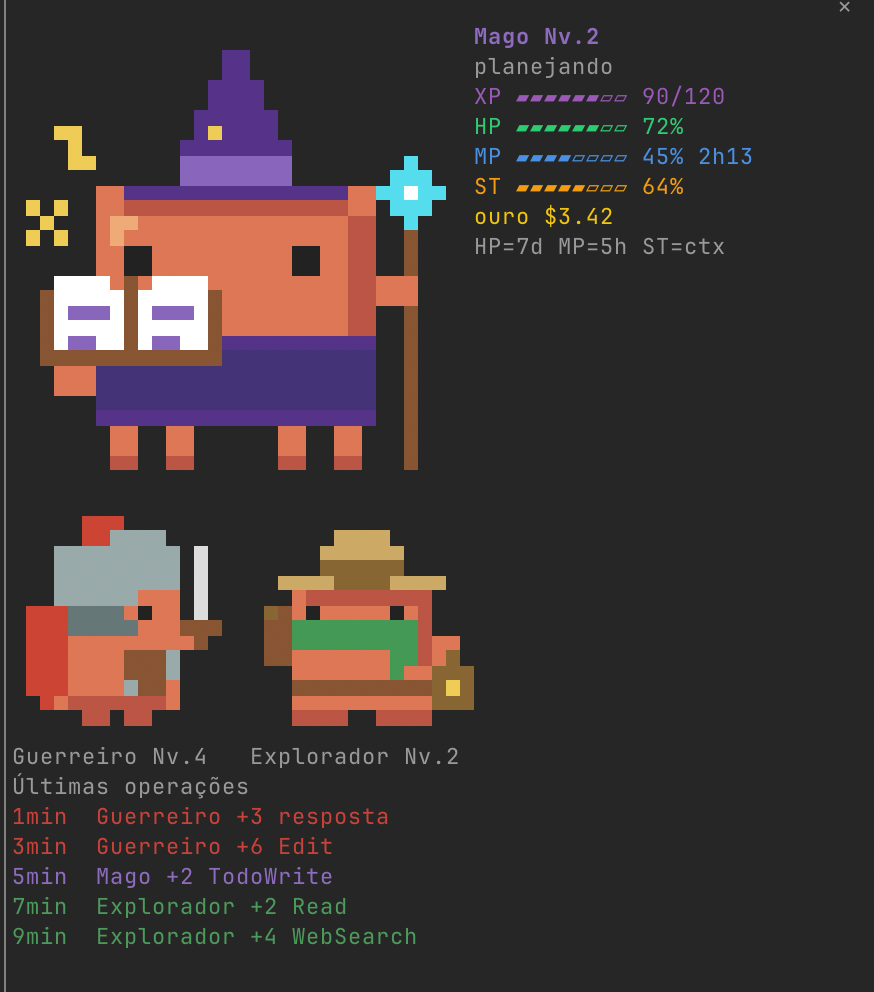
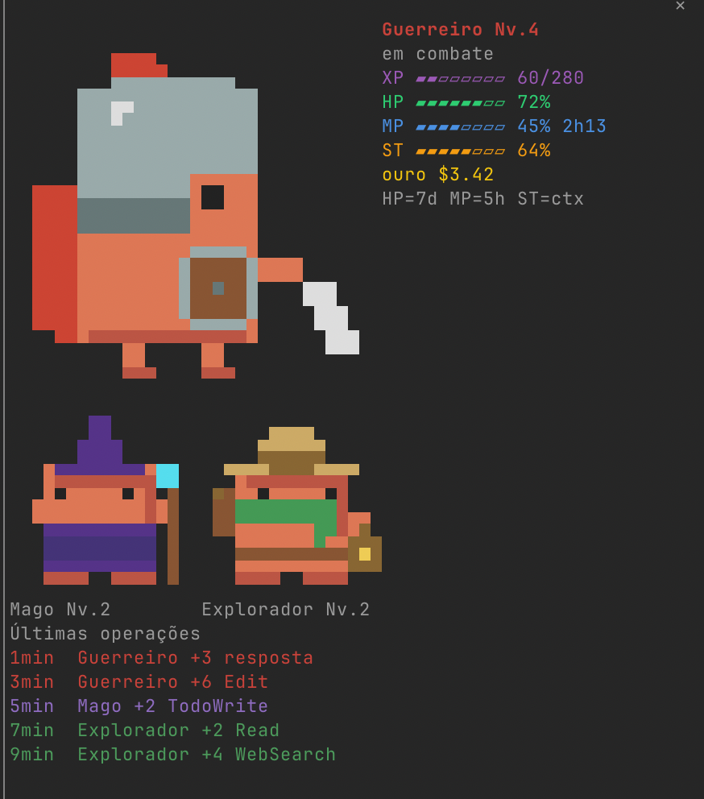
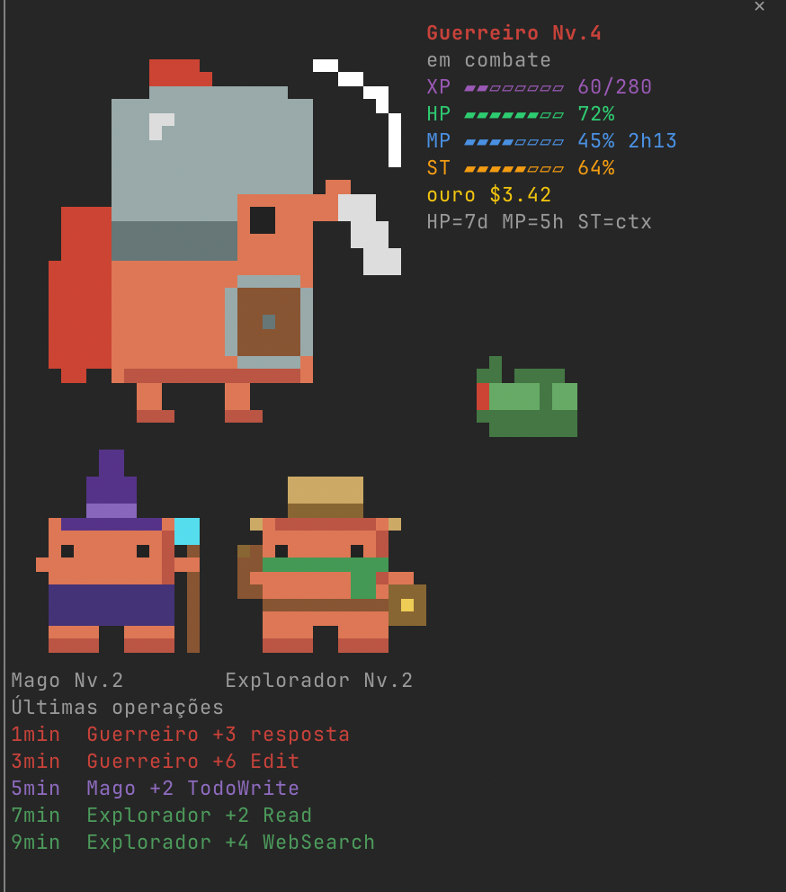
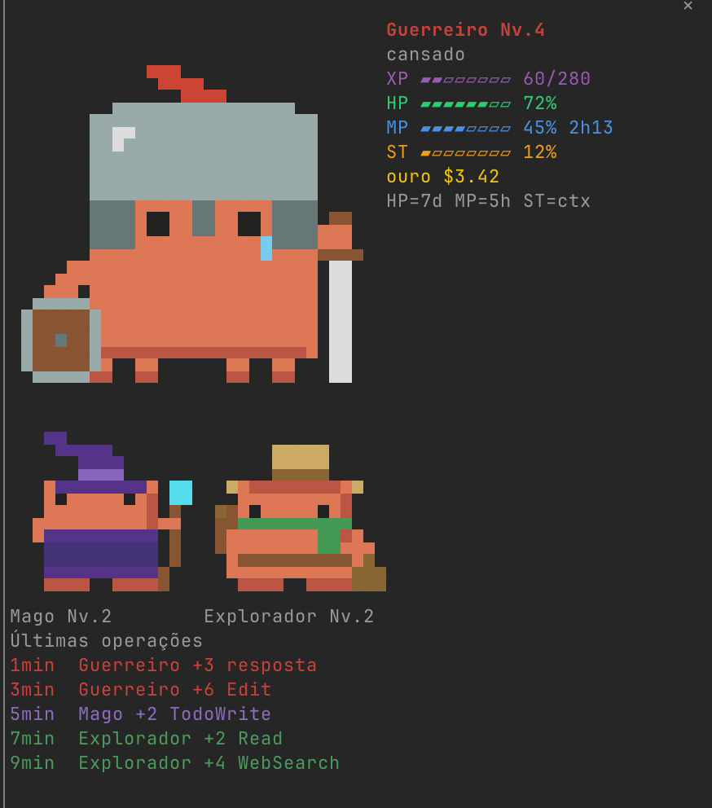
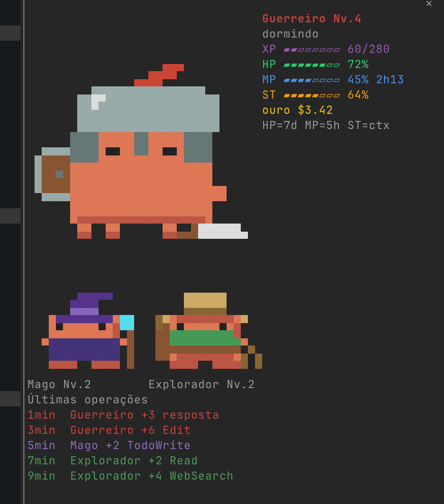

# Guild Monitor

[English](README.md) · **Português**

Um mod do [Claude Code](https://claude.com/claude-code) que transforma o monitor da sessão num pequeno RPG. Uma guilda de três personagens em pixel art vive num painel lateral (ou numa barra acima do prompt), trabalha enquanto o agente trabalha e sobe de nível conforme as tarefas são concluídas. Seus limites de uso, a janela de contexto e o custo aparecem como medidores de jogo.

> **Sem afiliação com a Anthropic.** O mascote laranja é uma homenagem de fã ao mascote do Claude Code. "Claude" e "Claude Code" são marcas da Anthropic.

<p align="center">
  
  
  
  
</p>

## O que faz

- **Três personagens, um para cada tipo de trabalho.** Quem está em cena acompanha o que o agente está *fazendo*, não o que você digitou.
- **Animados no terminal.** Sprites em tamanho cheio (32×16 células) desenhados com meio-bloco e truecolor, sem precisar de protocolo de imagem. Funciona no iTerm2, no foot e dentro do tmux.
- **Medidores** para o limite de 7 dias, o de 5 horas, a janela de contexto e o custo da sessão.
- **XP e nível por classe**, pagos por operação e guardados entre sessões.
- **Um bug** que aparece a cada chamada de ferramenta que falha, é derrotado quando ela volta a funcionar e some sozinho após 2 minutos sem novo erro.

## A guilda

| Personagem | Faz | Entra em cena quando o agente… |
|---|---|---|
| **Mago** | planeja | está em modo plano ou organiza o trabalho (`TodoWrite`, `AskUserQuestion`, tarefas de plano, subagentes `Plan`) |
| **Guerreiro** | executa e corrige | altera coisas: `Edit`, `Write`, `MultiEdit`, comandos de shell que não são só leitura, outros subagentes |
| **Explorador** *(padrão)* | pesquisa e investiga | lê ou busca: `Read`, `Grep`, `Glob`, `WebSearch`, `WebFetch`, comandos de shell só de leitura, subagentes `Explore` |

Quem está em cena é a classe da maioria das **três últimas chamadas de ferramenta** (empate vai para a mais recente). Antes da primeira chamada do turno, o prompt dá um primeiro palpite ("corrija o bug" → Guerreiro, "planeje a feature" → Mago); sem nada a que se agarrar, é o Explorador.

### Estados

| Estado | Quando | Animação |
|---|---|---|
| trabalhando | há um turno em andamento | o personagem ativo trabalha |
| cansado | contexto ≥ 75% (configurável) | todos parecem exaustos |
| dormindo | 90 s sem atividade (configurável) | todos dormem |
| parado | nos demais casos | todos esperam, piscando |

<table align="center">
  <tr>
    <td align="center"><br>Mago trabalhando</td>
    <td align="center"><br>Guerreiro trabalhando</td>
    <td align="center"><br>Explorador trabalhando</td>
    <td align="center"><br>Bug</td>
  </tr>
  <tr>
    <td align="center"><br>Parado</td>
    <td align="center"><br>Cansado</td>
    <td align="center"><br>Dormindo</td>
    <td align="center"><br>Derrotado</td>
  </tr>
</table>

## Medidores

| Medidor | Mostra | Cor |
|---|---|---|
| **HP** | o que resta da janela de uso de 7 dias | verde acima de 50%, amarelo de 25% a 50%, vermelho abaixo de 25% |
| **MP** | o que resta da janela de 5 horas, com o tempo até ela reiniciar | azul |
| **ST** (stamina) | o que resta da janela de contexto | laranja |
| **Ouro** | quanto a sessão custou, em USD | dourado |
| **XP** | progresso até o próximo nível do personagem ativo | roxo |

HP e MP vêm dos limites da sua assinatura: fora de uma assinatura (por exemplo, com chave de API) mostram `--`. Um valor que a sessão ainda não informou mantém o último conhecido, então os medidores nunca se apagam ao trocar de personagem.

## Avisos de limite baixo

HP, MP e stamina avisam em toast antes de um limite estourar: quando o que **sobra** de um medidor cai abaixo de **20%** e depois abaixo de **10%**. O texto é em português e diz o valor e o tempo até o reset, por exemplo `O Mago está quase sem mana: 18%, reinicia em 1h40` (o HP de 7 dias usa dias: `reinicia em 3d 5h`). A stamina não tem reset; o toast dela lembra que o `/compact` a recupera: `O Explorador está quase sem fôlego: 18%. /compact recupera`.

- **Uma vez por ciclo.** Cada faixa avisa uma vez. Ela só avisa de novo depois que o valor volta acima dela por 5 pontos (25% para a faixa de 20%, 15% para a de 10%), quando a janela reinicia ou, na stamina, depois de uma compactação que a recuperou (a leitura velha logo depois de compactar não avisa de novo). Uma queda que passa as duas faixas de uma vez mostra só a de 10%.
- **Sem valor, sem aviso.** Um medidor que o engine não informa (HP e MP fora de uma assinatura) não avisa nem rearma; o aviso de stamina funciona sem assinatura.
- **Só em memória.** O que já foi avisado vive na memória e some com a sessão, então um restart pode avisar mais uma vez. Nada vai ao store nem ao registro do `/guild trace`, e nenhum toast leva caminho, prompt ou comando.
- **Cenas de demonstração.** Nunca avisam.
- **A opção `alerts`.** `on` (padrão) ou `off`. Com `off` a guilda não mostra nenhum toast, inclusive o de descanso da compactação.

## Previsão das janelas

Ao lado de HP e MP a guilda diz quando cada janela se esgota **no ritmo atual**: `5h esgota em ~40min`, `7d esgota em ~3 dias`, `5h dura até o reset` (dura até a janela reiniciar) ou `7d sem consumo` (nada está sendo gasto). Fica vermelha quando a janela se esgota antes de reiniciar.

- A estimativa vem das leituras dos limites que o plugin já faz, com a inclinação média das mais recentes (a última hora na janela de 5 horas, os últimos dois dias na semana). A porcentagem anda em pontos inteiros, então só diz algo com pelo menos 3 leituras, ao longo de 10 minutos (2 horas na semana) e uma variação de 2 pontos. Antes disso nada aparece: **a previsão nunca inventa um número**. O tempo sobe em passos de 5 minutos; a semana mostra dias.
- Quando uma janela reinicia (novo horário de reset, ou a porcentagem cai) as leituras recomeçam, e a previsão volta quando houver leituras novas suficientes. Uma janela que a sessão deixa de informar deixa de ser prevista.
- No painel lateral cada janela tem a sua linha, abaixo da legenda. Na barra inferior cabe uma: a janela que se esgota antes de reiniciar, senão a de 5 horas. Na barra compacta (8 linhas) ela ocupa a linha da legenda e cede ao aviso `bug na área!`. Num painel estreito o texto perde o `em` (`5h esgota ~40min`) e, se nem assim couber, a linha some.
- Só as leituras recentes existem, na memória: nada vai para o store, para o registro de `/guild trace` nem para um toast. A opção `showForecast` em `off` esconde tudo.
- As cenas demo mostram uma previsão fictícia: `5h esgota em ~1h30` em vermelho e `7d dura até o reset`.

## XP e níveis

Cada chamada de ferramenta que termina **sem erro** paga XP na hora à classe a que pertence, então uma tarefa que explora, planeja e depois executa alimenta os três personagens:

```
XP da operação = 2  +  min(segundos / 2, 4)  +  min(linhas escritas / 20, 4)      (no máximo 10)
```

- O tempo é quanto a chamada durou. As linhas são o que uma edição ou um arquivo novo escreveu.
- Derrotar um bug paga **+10** à classe que fez a chamada que passou.
- Um turno que termina com uma resposta paga **+3** à classe ativa.
- Turnos interrompidos mantêm o que já foi pago.

O nível `n` começa em `40 × (n − 1)²` de XP: nível 2 com 40, nível 3 com 160, nível 4 com 360, nível 5 com 640. O XP fica salvo no armazenamento do plugin (`guild.v1`) e sobrevive a reinícios. Um aviso anuncia cada nível novo.

## O bug

Quando uma chamada de ferramenta falha, o bug aparece embaixo dos status do personagem ativo. Uma chamada bem-sucedida **do mesmo tipo** depois dele o derrota (em comandos de shell, o mesmo programa e subcomando: `npm test`, `git push`; nas demais ferramentas, a mesma ferramenta). Se nenhuma chamada do mesmo tipo voltar, o bug some sozinho após **2 minutos sem novo erro de ferramenta**; um novo erro reinicia essa contagem. Chamadas recusadas por permissão ou por um hook, e as que **você mesmo recusa** (um plano recusado, uma permissão negada, uma pergunta interrompida), não contam como falha: não criam bug, não derrotam o bug vivo e não pagam XP. No `/guild trace` elas aparecem como `RECUSADA`, e não como `ERRO`. Reconhecer uma recusa é melhor esforço: um plano ou uma pergunta recusados são sempre reconhecidos, mas nas demais ferramentas isso depende do texto de recusa do engine, que pode mudar entre versões, e um comando de shell que você interrompe em andamento ainda cria bug.

## O que o personagem está fazendo agora

Uma linha no topo do painel lateral (e no topo dos status na barra inferior, quando cabem) diz o que o personagem ativo está fazendo agora, por exemplo `Guerreiro: editando register.tsx` ou `Explorador: pesquisando na web`.

- A linha acompanha as chamadas de ferramenta: aparece quando a chamada começa e some quando ela termina, seja com sucesso, erro ou recusa por permissão ou hook. Com várias chamadas em paralelo, vale a mais recente que ainda não terminou. Uma chamada que espera a sua permissão aparece como em andamento até você responder, e some quando é recusada: a checagem de permissão do engine roda depois do hook deste mod e a resposta do diálogo não é observável, então não dá para distinguir a chamada recusada antes.
- Um verbo por tipo de ferramenta: `lendo` (Read), `buscando` (Grep, Glob), `pesquisando na web` (WebSearch, WebFetch), `editando` (Edit), `escrevendo` (Write), `executando` (Bash), `planejando` (planos e listas de tarefas) e `chamando um aliado` (subagentes; o que o subagente faz por dentro não aparece).
- O alvo é só o nome do arquivo, sem o diretório, ou, num comando de shell, só o programa e um subcomando simples (`npm test`, `git commit`), cortado em 24 caracteres. Flags, valores, atribuições `NOME=valor`, URLs e credenciais nunca aparecem, já que o painel pode ser compartilhado ou capturado; `…` marca o que ficou de fora. Ele existe **só na tela e na memória**: nunca é salvo no store nem no registro do `/guild trace`.
- Quando nada roda, ou o turno termina, a linha mostra o repouso: `de prontidão`, `cansado` ou `dormindo`.
- Num painel estreito a linha abre mão do nome, depois do alvo, e termina só com o verbo.
- As cenas de demonstração `explorador`, `mago`, `guerreiro` e `bug` mostram uma chamada em andamento; `cansado` e `dormindo` mostram o repouso. As capturas abaixo são anteriores a essa linha e não a mostram.

## Timers de sessão e de turno

O painel lateral mostra dois timers, logo acima das últimas operações: `sessão 1h05` (há quanto tempo a sessão está aberta) e `turno 32s` (há quanto tempo o turno atual roda). O formato é curto: `32s` abaixo de um minuto, `4min` abaixo de uma hora, `1h05` depois disso.

- **Timer da sessão.** Conta a partir do início real da sessão, informado pelo engine: uma sessão retomada conta desde o primeiro início, e o `/clear` recomeça a conta (o novo início é lido em até 2 segundos). Mostra `--` enquanto o início é desconhecido.
- **Timer do turno.** Roda do seu prompt até a resposta; então para e guarda a duração final, a que o engine informa quando o turno termina (não uma subtração local), até o próximo turno começar. Mostra `--` antes do primeiro turno. Um turno interrompido ou com erro também guarda a duração.
- **Barra inferior.** Mostra só o timer do turno, na linha do ouro (`ouro $1.50 · turno 32s`), e só enquanto um turno roda, de modo que as 8 linhas da barra compacta continuam valendo.
- **Redesenho.** Os timers ficam em segundos inteiros, então a view muda (e o painel redesenha) uma vez por segundo, não a cada quadro da animação. Nada disso é salvo no store, no registro do `/guild trace` nem em toast.
- **Cenas de demonstração.** Todas mostram os dois timers: `explorador`, `mago`, `guerreiro` e `bug` com uma sessão aberta há `1h05` e um turno rodando há `32s`; `cansado` e `dormindo` com `1h05` e os `4min` do último turno.

## Combo e bugs derrotados

O painel lateral tem uma linha de contadores logo acima da divisão do ouro e dos timers de sessão e de turno, por exemplo `combo x7 · melhor x9 · bugs 3`: o **combo** (operações seguidas que terminaram sem erro), o **melhor combo** da sessão e os **bugs derrotados** na sessão.

- **Combo.** Cresce a cada operação que termina sem erro e zera numa falha; a falha ainda levanta o bug, como antes. Chamadas que você ou um hook recusaram, e chamadas de subagentes, são ignoradas: não sobem nem zeram o combo (a mesma regra do XP).
- **Escondido abaixo de 3.** O combo e o melhor combo só aparecem a partir de 3, para não encher o painel de `x1`. Antes disso a linha é só `bugs 0`.
- **Bugs derrotados.** Cada derrota conta uma vez: o instante em que um bug vivo cai, o mesmo que paga o bônus de XP.
- **Dano causado.** Depois dos bugs, a linha mostra o resultado material do trabalho, por exemplo `bugs 3 · 3 arquivos · 142 linhas · 8 comandos`: os **arquivos distintos** editados (`Edit`, `Write`, `MultiEdit`, `NotebookEdit`; o mesmo arquivo editado de novo conta uma vez), as **linhas** escritas (o mesmo valor que alimenta o XP) e os **comandos de shell** rodados. Só contam operações que deram certo, pela mesma regra do XP. Os três ficam escondidos enquanto todos forem zero. Dos arquivos só se guarda em memória uma impressão curta, nunca o caminho, e apenas os últimos 1000 distintos.
- **Compactações.** Cada vez que o agente principal compacta o contexto (o seu `/compact` ou a compactação automática) a linha termina com `1 compactação`, `2 compactações`, e nada enquanto não houver nenhuma. Compactações de subagentes, as vetadas e o `precompute` do engine não contam. O segmento é o primeiro a sair num painel estreito: na forma curta (`2 compact.`) e depois removido, antes do dano.
- **Toast de descanso.** Compactar recupera a stamina, então a guilda avisa: `A guilda descansou: ST recuperada de 12% para 64%`. O evento de compactação não traz o novo percentual, por isso o toast aparece quando chega a próxima medição, com a stamina conhecida antes da compactação e a medida depois dela. Só aparece quando a stamina subiu. Ele segue a opção `alerts`: com `off` não aparece.
- **Só em memória.** Nada vai ao store nem ao registro do `/guild trace`, nenhum toast leva caminho ou contagem (o toast de descanso só tem os dois percentuais), e tudo recomeça com a sessão. Os totais vitalícios são outra funcionalidade.
- **Barra inferior.** Não mostra os contadores, de modo que as 8 linhas da barra compacta continuam valendo.
- **Cenas de demonstração.** Todas mostram valores fictícios, `combo x7 · melhor x9 · bugs 3`; a cena `bug` acabou de perder o combo e mostra `melhor x9 · bugs 3`.

## Ouro por classe (estimativa)

O painel lateral divide o custo da sessão entre os três personagens, entre os contadores e o timer de sessão:

```
Mago ~$1.20 (35%)
Guerreiro ~$1.71 (50%)
Explorador ~$0.51 (15%)
```

É uma **estimativa**, não contabilidade: é isso que o `~` quer dizer. O custo chega em leituras separadas (a cada 2 segundos e sempre que o engine informa uma medição) e o plugin não sabe qual chamada causou qual parte dele.

- **A regra.** A variação do custo entre duas leituras vai para a classe das operações que terminaram nesse intervalo. Se mais de uma classe trabalhou nele, a variação é dividida em proporção ao número de operações de cada classe; sem operação (o modelo só respondeu), vai para a classe ativa. A primeira leitura é só o ponto de partida: não atribui nada, então numa sessão retomada a divisão soma o que foi gasto desde que o plugin começou a observar.
- **Sempre fecha a conta.** Os três valores somam exatamente a variação do custo desde esse ponto de partida (o dinheiro é contado em micro-dólares inteiros, sem deriva de ponto flutuante). Os percentuais somam 100: cada um é arredondado para baixo e o resto vai para as maiores frações. Os valores aparecem arredondados em centavos.
- **Sessões retomadas.** A primeira leitura é só o ponto de partida, então numa sessão retomada as três linhas somam menos que a linha `ouro` (a sessão inteira). Quando esse custo inicial é maior que zero, uma legenda apagada, `desde a abertura`, aparece logo abaixo das linhas (some se o painel for estreito demais para ela, e uma sessão nova, que começa em zero, não tem legenda).
- **Leituras estranhas.** Um custo que não mudou não atribui nada. Um custo que cai (um `/clear` reinicia o custo da sessão) zera a divisão e recomeça do novo valor. Uma leitura ausente, `NaN`, negativa ou acima de um bilhão de dólares é ignorada por inteiro.
- **Operações.** Toda chamada de ferramenta do agente principal que termina dentro de um turno conta, tenha dado certo ou falhado. Chamadas que você ou um hook recusaram não contam. Chamadas de subagentes são ignoradas (o mesmo guard do XP e do combo, `agentId`): o que um subagente custa faz parte do custo da sessão e vai para a classe do agente principal que rodou no intervalo.
- **Sem linhas antes de uma variação.** Enquanto o custo não mudou uma vez, as linhas não aparecem.
- **Painel estreito.** As três linhas usam sempre a mesma forma, a maior que cabe: `Mago ~$1.20 (35%)`, depois `Mago ~$1.20 35%`, depois `Mag ~$1.20 35%`, depois só `~$1.20 35%`; se nem essa couber, as linhas somem.
- **Só da sessão.** Nada vai ao store, ao registro do `/guild trace` nem a toast, e tudo recomeça com a sessão. Um histórico por classe é outra funcionalidade.
- **Barra inferior.** Não mostra a divisão, de modo que as 8 linhas da barra compacta continuam valendo.
- **Cenas de demonstração.** Todas mostram uma divisão fictícia que soma os $3.42 do demo: `Mago ~$1.20 (35%)`, `Guerreiro ~$1.71 (50%)` e `Explorador ~$0.51 (15%)`.

## Tokens e taxa de acerto do cache

O painel lateral mostra, logo acima das últimas operações, quanto a sessão gastou em tokens e quanto o cache de prompt ajudou:

```
tokens  input 142k · output 18k · cache 87%
sessão  input 1,2M · output 96k · cache 91%
subagentes input 30k · output 4,1k · cache 38%
```

- **Três linhas.** `tokens` é o último turno do agente principal que trouxe consumo, `sessão` é o acumulado da sessão e `subagentes` é o acumulado dos turnos de subagentes, numa linha só deles para não misturar com a do agente principal (ela só existe depois do primeiro turno de subagente; sem nenhum turno principal, é a única).
- **Os números.** Os dados vêm do fim de cada turno: input não-cacheado, output, cache lido e cache escrito. O `input` mostrado é tudo o que o modelo leu (não-cacheado + cache lido + cache escrito). A **taxa de acerto do cache** é cache lido / (cache lido + input não-cacheado + cache escrito), por turno e acumulada (a taxa da soma, não a média das taxas). Quando não há como calcular (só output), a linha diz `cache --`.
- **Abreviação.** Um formatador único abrevia com vírgula decimal: `999`, `12,4k`, `142k`, `1,2M`.
- **Taxa baixa.** Abaixo de 50% a linha fica em vermelho; 50% ou mais usa a cor normal.
- **Turno sem consumo.** Um turno interrompido ou terminado por erro de API não traz consumo e não soma nada; as linhas ficam como estavam (e não aparecem antes do primeiro turno com consumo).
- **Modelo.** O modelo do último turno principal aparece apagado ao lado do nome do personagem ativo (`Guerreiro Nv.3 sonnet-5-5`, sem o prefixo `claude-` nem a data). Se não couber, mostra só a família (`sonnet`) e, se nem assim, some.
- **Painel estreito.** Cada linha usa a maior forma que cabe: `tokens  input 142k · output 18k · cache 87%`, depois `tokens  in 142k · out 18k · 87%`, depois `tokens  142k/18k 87%`, depois só `tokens  87%`; se nem a última couber, a linha some.
- **Barra inferior.** Não mostra as linhas de tokens (as 8 linhas da barra compacta continuam valendo); mostra só o modelo apagado ao lado do nome.
- **Só em memória.** Nada vai ao store, ao registro do `/guild trace` nem a toast, e tudo recomeça com a sessão.
- **Cenas de demonstração.** Todas mostram valores fictícios: `tokens  input 142k · output 18k · cache 87%`, `sessão  input 1,2M · output 96k · cache 91%` e `subagentes input 30k · output 4,1k · cache 38%` (esta em vermelho, para mostrar a taxa baixa), com o modelo `sonnet-5-5` ao lado do nome. Enquanto uma cena roda, o consumo real é ignorado.

## Esquemas de cores dos medidores

Os medidores e as linhas de texto podem usar um de três esquemas de cores, independentes das cores dos personagens:

| Esquema | O que é |
|---|---|
| `padrao` | as cores de sempre (HP verde, amarelo e vermelho; MP azul; ST laranja; XP roxo; ouro amarelo; desconhecido cinza) |
| `contraste` | alto contraste: cores vivas com pelo menos 7:1 contra o preto (WCAG AAA) |
| `daltonico` | não depende de verde contra vermelho: a paleta [Okabe-Ito](https://jfly.uni-koeln.de/color/), feita para ser distinguida com protanopia, deuteranopia e tritanopia. Os três níveis de HP também diferem em luminosidade (azul claro, azul-céu, vermelhão), então o HP se lê sem distinguir matizes |

- **Opção e comando.** A opção `meters` define o esquema (`padrao`, `contraste` ou `daltonico`; padrão `padrao`). `/guild meters NOME` troca na hora, **salva a escolha** para as próximas sessões e responde `Esquema dos medidores: NOME (salvo)`; `/guild meters` sem nome lista os esquemas com o atual marcado `(atual)`; um nome desconhecido não muda nada e mostra os válidos. A escolha salva vale mais que a opção; sem escolha salva vale a opção. Durante uma cena de demonstração `esquema-*` a cena mantém o esquema dela na tela: `/guild meters` ainda salva, e a resposta avisa que o salvo aparece depois de `/guild off`.
- **Onde vale.** A barra, o painel lateral e as cenas de demonstração: os medidores, as linhas de previsão e de tokens, os contadores e o aviso do bug. As cores das classes (nome, o que o personagem faz, ouro por classe, últimas operações) e os sprites não mudam.
- **O cinza de desconhecido.** O `--` de um valor que ninguém informou mantém um cinza que continua distinguível em todos os esquemas.
- **Cenas de demonstração.** `esquema-padrao`, `esquema-contraste` e `esquema-daltonico` (`/guild esquema-daltonico`) mostram o guerreiro trabalhando naquele esquema, seja qual for o salvo, e não salvam nada; o HP passa por 72%, 38% e 15% a cada 3 segundos, então os três níveis de HP aparecem. `/guild off` volta à sessão real e ao esquema salvo.
- **Privacidade.** Só o nome do esquema é salvo, junto com o estado aberto/fechado do painel, nas preferências da interface; nunca dado de sessão.
- **Nota de acessibilidade.** O esquema `daltonico` é verificado por testes contra os tipos comuns de daltonismo (protanopia, deuteranopia, tritanopia, simulados com o modelo de Machado, Oliveira e Fernandes, 2009): dois medidores nunca ficam mais próximos que uma distância de cor definida, e os três níveis de HP diferem em luminância. Toda cor do `daltonico` também mantém pelo menos 4,5:1 contra o preto (WCAG AA), verificado por teste; por isso o MP é um azul Okabe-Ito clareado e o valor desconhecido um cinza claro. Os esquemas supõem fundo escuro no terminal.

## Painel lateral

Num terminal largo, no layout de tela cheia do Claude Code (`/tui fullscreen`, 110 colunas ou mais), a guilda abre como um **painel à esquerda da conversa**:

- o personagem ativo em tamanho cheio, com os status **ao lado**, e o bug logo embaixo dos status quando uma chamada de ferramenta falha;
- os outros dois personagens embaixo, e a lista das **últimas pagas de XP** (`3min Guerreiro +6 Edit`);
- a largura é sua: arraste a borda do painel e o layout acompanha (os status descem para baixo do personagem quando estreito, depois o personagem encolhe);
- o **×** no canto do painel fecha e traz a barra inferior de volta; `/guild panel` abre de novo.

Ele abre sozinho a partir de 144 colunas (110 depois que você mesmo o abriu), a não ser que você o tenha fechado: a escolha fica guardada. Onde não há espaço (terminal estreito ou o layout clássico, sem tela cheia), a guilda continua como a barra acima do prompt, então nunca fica sem guilda.

<table>
  <tr>
    <td align="center"><br>Explorador</td>
    <td align="center"><br>Mago</td>
    <td align="center"><br>Guerreiro</td>
  </tr>
  <tr>
    <td align="center"><br>Bug</td>
    <td align="center"><br>Cansado</td>
    <td align="center"><br>Dormindo</td>
  </tr>
</table>

| Comando | Faz |
|---|---|
| `/guild panel` | abre o painel lateral e passa a abri-lo sempre |
| `/guild bar` | fecha o painel e volta à barra inferior |
| `/guild trace [N\|clear]` | mostra o registro das últimas N chamadas de ferramenta (padrão 20): quem estava em cena, quem ganhou o XP (`ERRO` marca uma falha, `RECUSADA` uma chamada que você recusou) e um resumo; `clear` apaga. Só nomes de ferramenta, classes e o nome do programa de um comando de shell são guardados, nunca prompts, caminhos, argumentos nem variáveis |
| `/guild meters [nome]` | troca na hora o esquema de cores dos medidores (`padrao`, `contraste`, `daltonico`) e o guarda para as próximas sessões; sem nome, lista os esquemas |
| `/guild <cena>` | mostra uma cena de demonstração (`explorador`, `mago`, `guerreiro`, `bug`, `cansado`, `dormindo`, `esquema-padrao`, `esquema-contraste`, `esquema-daltonico`); `/guild off` volta à sessão real |

## Requisitos

- Claude Code com suporte a mods. Desenvolvido e testado na **2.1.302**.
- Terminal com truecolor. Testado no **iTerm2** (macOS) e no **foot** (Linux), com e sem **tmux** (use `set -ga terminal-features ",*:RGB"` ou `Tc` se as cores ficarem apagadas).
- Para o painel lateral: o layout de tela cheia (`/tui fullscreen`) e 110 colunas ou mais. Para a barra inferior: 16 linhas livres acima do prompt (a reduzida usa 8).

## Instalação

Escolha uma.

**1. Pelo marketplace deste repositório**

```sh
claude plugin marketplace add viniciusilveira/guild-monitor
claude plugin install guild-monitor@guild-monitor
```

**2. A partir de um clone, para uma sessão**

```sh
git clone https://github.com/viniciusilveira/guild-monitor.git
claude --plugin-dir ./guild-monitor
```

**3. A partir de um clone, para todas as sessões**

```sh
export CLAUDE_CODE_PLUGIN_DIRS="$HOME/guild-monitor"
```

Reinicie o Claude Code e a guilda aparece acima do prompt.

## Configuração

| Opção | Padrão | O que faz |
|---|---|---|
| `sleepAfterSeconds` | `90` | tempo ocioso depois do qual a guilda dorme |
| `tiredAtPercent` | `75` | preenchimento do contexto em que todos ficam cansados |
| `bandSize` | `full` | `full`: personagem ativo em tamanho cheio (16 linhas); `compact`: todos reduzidos (8 linhas) |
| `layout` | `auto` | `auto`: painel lateral onde couber, barra inferior no resto; `bar`: só a barra; `panel`: só o painel |
| `meters` | `padrao` | esquema de cores dos medidores: `padrao`, `contraste` (alto contraste) ou `daltonico` (para daltonismo); o salvo com `/guild meters` vale mais |
| `demo` | `off` | uma cena fixa com valores fictícios: `explorador`, `mago`, `guerreiro`, `bug`, `cansado`, `dormindo`, ou uma por esquema de cores: `esquema-padrao`, `esquema-contraste`, `esquema-daltonico` |
| `showForecast` | `on` | `on`: mostra quando as janelas de 5 horas e de 7 dias se esgotam no ritmo atual; `off`: esconde a previsão |
| `alerts` | `on` | `on`: toasts quando HP, MP ou stamina caem abaixo de 20% e de 10%, e quando uma compactação descansa a guilda; `off`: nenhum toast |

Defina-as na instalação (`claude plugin install … --config bandSize=compact`), com `claude plugin configure guild-monitor` ou em `/plugin`.

A banda se adapta ao terminal: primeiro o personagem ativo, depois os status ao lado, depois os outros dois personagens. Ela se esconde quando nem o personagem ativo cabe.

### Modo demo

O `demo` mostra números inventados (HP 72%, MP 45% com 2h13 para reiniciar, ST 64%, $3,42, um Guerreiro nível 4, e uma previsão: a janela de 5 horas se esgotando em `~1h30`) numa cena fixa e **ignora a sessão real e não salva nada**. Útil para prints e para um primeiro contato. Deixe em `off` no uso real.

Não precisa reiniciar para trocar de cena: digite `/guild bug` (ou qualquer outra cena) e a banda muda na hora; `/guild off` volta à sessão real. O comando vale só para a sessão atual.

## Capturas da barra inferior

<table>
  <tr>
    <td align="center"><br>Explorador</td>
    <td align="center"><br>Mago</td>
    <td align="center"><br>Guerreiro</td>
  </tr>
  <tr>
    <td align="center"><br>Bug</td>
    <td align="center"><br>Cansado</td>
    <td align="center"><br>Dormindo</td>
  </tr>
</table>


## Desenvolvimento

Para conferir uma mudança, rode o comando único que o CI também roda (`npm ci` uma vez para instalar o TypeScript fixado):

```sh
scripts/verify             # tipos, testes e validação do plugin; para na primeira falha
```

Os passos, um a um:

```sh
claude plugin test .       # testes unitários dos módulos puros e do que a banda e o painel mostram
claude plugin validate .   # checagem do manifesto e dos hooks
tsc -p .                   # checagem de tipos (veja abaixo)
node scripts/build-sprites.mjs   # reconstrói hooks/sprites.generated.ts a partir de art/
```

- `.claude-plugin/types/` guarda as declarações de tipos do Claude Code, que o engine grava ali ao carregar o plugin como mod. Está no `.gitignore`; o `tsc -p .` precisa dela, então o `scripts/verify` para com uma mensagem quando ela falta (o CI define `VERIFY_SKIP_TYPES=1` e pula a checagem de tipos).
- `scripts/engine-check` roda uma sessão curta de `claude -p` com o plugin instalado e confere se os hooks gravaram o registro. Precisa de um Claude Code logado, então é para a máquina de quem desenvolve, não para o CI.
- Toda a lógica está em módulos puros pequenos e testados: `classify.ts` (quem está em cena), `guild.ts` (estados de animação e o bug), `counters.ts` (combo, bugs derrotados e a linha de contadores), `damage.ts` (arquivos, linhas e comandos que deram certo), `compactions.ts` (compactações e o toast de descanso), `alerts.ts` (quando um medidor cruza 20% ou 10%, e o texto do aviso), `forecast.ts` (quando as janelas de uso se esgotam), `xp.ts` (XP e níveis), `tracker.ts` (tudo o que a guilda lembra), `view.ts` (o que a banda mostra), `doing.ts` (verbos e alvos da linha), `layout.ts`, `raster.ts` (sprite → células de meio-bloco), `gold.ts` (ouro por classe), `tokens.ts` (tokens, taxa do cache e números abreviados), `demo.ts`, `schemes.ts` (esquemas de cores dos medidores), `choices.ts` (escolhas nomeadas guardadas entre sessões). Só `register.tsx` e `render.tsx` falam com o engine.
- O mod roda sem Node nem DOM, então não decodifica PNG. O `scripts/build-sprites.mjs` lê a exportação do Aseprite em `art/` e grava os quadros como dados (`hooks/sprites.generated.ts`), com uma versão em meio tamanho de cada um para os personagens pequenos.
- A arte foi feita no Aseprite (quadros de 32×32, uma paleta compartilhada de 21 cores).

## Roadmap

- Uma linha de status curta para quando a banda estiver escondida.

## Licença

[MIT](LICENSE), código e arte. Sem afiliação, endosso ou patrocínio da Anthropic.
